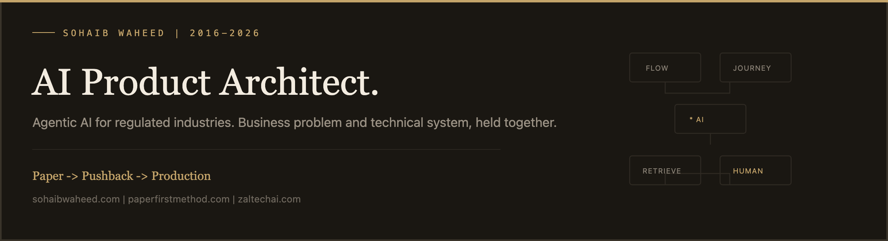
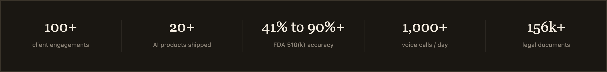
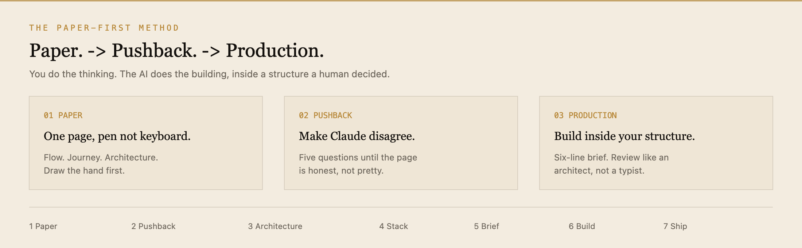

<div align="center">
  
</div>

<br/>

This work used to take four people: a product manager, a solutions architect, an engineer and a consultant. I sit with a business, find where AI creates real value rather than where it sounds impressive, design the architecture, and then build it — retrieval pipelines, multi-agent orchestration, voice systems, and the evaluation harnesses that keep them honest in production.

Most of that work now sits in **pharma, medtech and financial services**, where an answer that merely sounds right is not good enough.

<p align="center">
  <a href="https://sohaibwaheed.com">sohaibwaheed.com</a>
  &nbsp;·&nbsp;
  <a href="https://paperfirstmethod.com">the method</a>
  &nbsp;·&nbsp;
  <a href="https://zaltechai.com">Zaltech AI</a>
  &nbsp;·&nbsp;
  <a href="https://www.linkedin.com/in/sohaibwaheedpm">LinkedIn</a>
</p>

<div align="center">
  
</div>

---

## How I work

Every engagement starts with a discovery call. Scope is the problem, not a package. I turn down roughly **40%** of enquiries because a bad fit wastes both sides.

| | What you get |
|---|---|
| **Discovery** | The users, the constraints, an honest feasibility call, and a straight answer on fit |
| **Architecture & roadmap** | System and data design, evaluation criteria defined up front, decisions written down before code |
| **Build & ship** | Focused sprints, working software every week, integrations and tests in parallel |
| **Launch & support** | Production monitoring, real handover docs, 30 days of support, optional retainer |

Inside the studio the constraint is tighter: **ship every Friday**. Monday defines scope. Friday deploys. The rest of the week is for killing anything that is not the product.

---

## The Paper-First Method

<div align="center">
  
</div>

<br/>

AI can write the code in minutes. It cannot decide what is worth building. So every build starts on **one page**, then a voice session where Claude has to push back, then a six-line brief — before a single prompt is written.

I lost **$20,000** paying other people to build what I had specified but could not see. Paper-first is what I do now. **25–30+** applications have been built this way, including a live product sketched in the evening and shipped before midnight.

> If it isn't on a page, it isn't a plan yet.<br/>
> If your AI only agrees with you, you're decorating.<br/>
> Say what it must never do before what it should.

The method is free to use and share with credit: *The Paper-First Method by Sohaib Waheed* (CC BY 4.0). Worksheets, the starter kit and the seven steps live at **[paperfirstmethod.com](https://paperfirstmethod.com)**.

```
FLOW           who starts → sees → gets → ends
JOURNEY        first use · hard case · the save
ARCHITECTURE   services · data · ★ AI · ✋ human
```

One question grades every task I give an agent: **what happens if it's wrong?**

| Level | Meaning |
|---|---|
| 1 · Autonomous | The blast radius is small. It can run. |
| 2 · Assisted | A human reviews the output before it lands. |
| 3 · Human-led | A person owns the call. The agent prepares the work. |

---

## Selected work

Full case notes and product walkthroughs are on [sohaibwaheed.com](https://sohaibwaheed.com).

**IGENTIC AI — multi-agent compliance engine (medtech)**  
Architected a compliance system for FDA 510(k) submissions that lifted document accuracy from **41% to over 90%**. The platform won MedTech World's *Best Use of AI in Healthcare*. Pharma, medtech and financial-services work is the core of what I do now: traceable evidence, auditable reasoning, an output you can defend to a regulator.

**Voice AI — real estate and healthcare**  
Production agents on Vapi, Retell and ElevenLabs for qualification, scheduling and support. Deployed at **over 1,000 calls a day**.

**Legal research and drafting**  
RAG over a corpus of **156,000+** statutory and case documents in Chilean civil law. Sub-three-second queries. Research time down more than 80%.

**Proposal generation**  
Smart RFP automation that writes **50–60 page** proposals in minutes, with section-level editing, chat and live collaboration.

**Property intelligence**  
Ingest, normalise and analyse **500,000+** homeowner and property records. Automated enrichment, not a dashboard over a spreadsheet.

**Zagent AI**  
Type one prompt, get a live business. A no-code builder that plans the pages, generates the screens, scaffolds the API, then deploys in a single click.

Also shipped through the studio: HIPAA-aligned clinical documentation, an adaptive learning platform (reading, writing, speaking, listening), a medical-wellness booking assistant, and a mobile therapy product across CBT / DBT in chat, audio and video.

---

## What I take on

Engagements are scoped after discovery. These are the problems I keep saying yes to.

1. **Agentic AI for regulated industries** — compliance-grade systems for pharma, medtech and financial services.
2. **RAG and retrieval architecture** — Pinecone, Weaviate or ChromaDB, with an evaluation harness so retrieval quality stays measurable.
3. **Multi-agent orchestration** — LangGraph, LangChain, CrewAI. Designed so the second and third workflow cost a fraction of the first.
4. **Voice and conversational systems** — Vapi, Retell, ElevenLabs. Qualification, scheduling, support.
5. **AI integration** — CRMs, ERPs, Slack, internal tooling, via n8n, Make and direct API work. The existing stack stays intact.
6. **Fractional Head of Product / CPTO** — roadmap, discovery, positioning and architecture, held by one person who is accountable for the outcome.
7. **AI coaching for founders** — how to scope a product, pick models and tools, ship with AI-assisted development, and tell a real capability apart from a demo.

Already building? I also do an **architecture and feasibility review**: retrieval quality, evaluation setup, and where it will break before your users find out.

---

## Products I own

| | |
|---|---|
| **[Zaltech AI](https://zaltechai.com)** | The studio. White-label platforms I built and license, plus 100+ client engagements. London and Sydney. |
| **[Zagent AI](https://sohaibwaheed.com)** | Prompt-to-product builder. Plan, scaffold, deploy. |
| **[The Paper-First Method](https://paperfirstmethod.com)** | The process the studio actually runs on. |

Most of the GitHub work under this account is private client delivery. The public surface is the method, the sites, and the writing.

---

## Stack I keep reaching for

`Python` `FastAPI` `Next.js` `TypeScript`  
`LangGraph` `LangChain` `CrewAI`  
`Pinecone` `Weaviate` `ChromaDB`  
`Claude` `GPT-4` `Llama`  
`Vapi` `Retell` `ElevenLabs`  
`n8n` `Make` `Cursor`

I pick the stack. The model does not. Whatever ships has to be something I will own in production.

---

## A short timeline

| | |
|---|---|
| **2016** | UTS Sydney. Management consulting — frame the messy problem before reaching for a tool. |
| **2020** | First product work on Upwork. Later Expert-Vetted (top 1%). |
| **2021** | Paid $20,000 for software I had specified but could not see. Learned architecture, retrieval, agents, and the code. |
| **2023** | Founded [Zaltech AI](https://zaltechai.com). Production systems, not demos. |
| **2024–26** | Focused the studio on compliance-grade AI. IGENTIC, voice at 1,000+ calls/day, legal RAG, the Paper-First Method. |

Ten years. One direction of travel.

---

## Write to me

I reply when it is a real problem — a workflow, a regulated system, or a founder who wants to build the thing themselves.

- Site: [sohaibwaheed.com](https://sohaibwaheed.com)
- Method: [paperfirstmethod.com](https://paperfirstmethod.com)
- Studio: [zaltechai.com](https://zaltechai.com) · [info@zaltechai.com](mailto:info@zaltechai.com)
- LinkedIn: [sohaibwaheedpm](https://www.linkedin.com/in/sohaibwaheedpm)

<p align="center">
  <sub>Sohaib Waheed · Founder & Head of AI, Zaltech AI · London · Sydney</sub>
</p>
